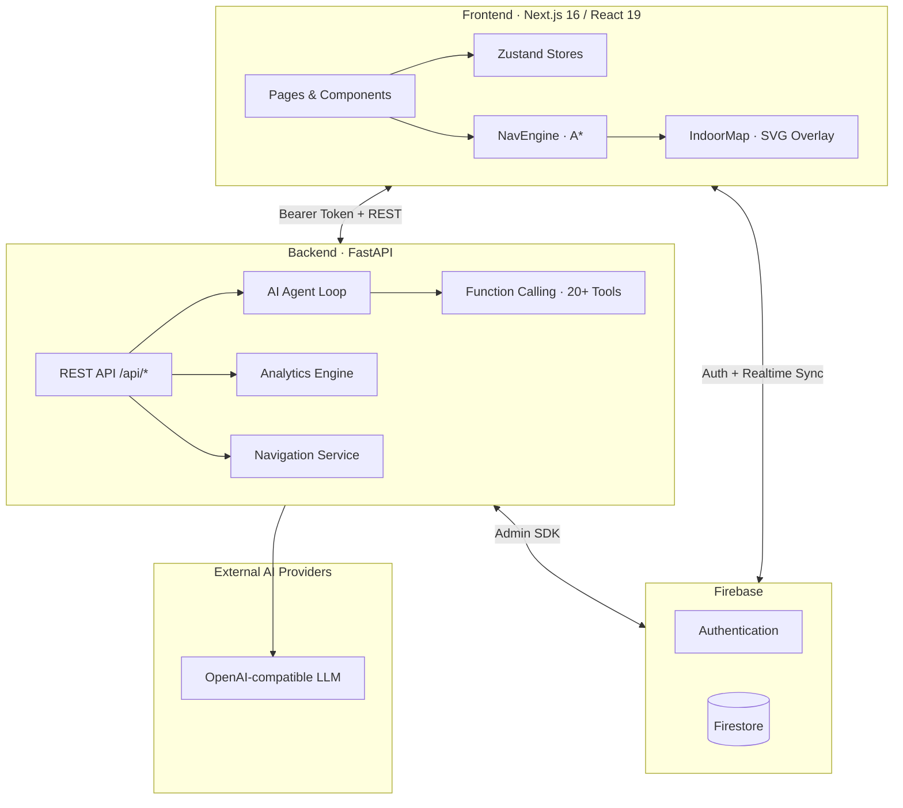

<div align="center">

# 🎓 UQU Academic Assistant

### **فطن** — Your intelligent companion for Umm Al-Qura University

[](https://nextjs.org/)
[](https://react.dev/)
[](https://fastapi.tiangolo.com/)
[](https://firebase.google.com/)
[](https://www.typescriptlang.org/)
[](https://www.python.org/)

**A full-stack academic portal with an AI agent, GPA intelligence, study planning, and smart indoor navigation across 89+ mapped rooms.**

[Features](#-features) · [Architecture](#-architecture) · [Quick Start](#-quick-start) · [Configuration](#-configuration) · [Indoor Navigation](#-indoor-navigation) · [AI Agent](#-ai-agent) · [Project Structure](#-project-structure)

</div>

---

## ✨ Overview

**UQU Academic Assistant** (*فطن*) is a production-oriented platform built for Umm Al-Qura University students. It unifies:

- A **hyper-contextual AI chat agent** that knows the student's transcript, goals, schedule, and academic calendar
- An **Academic Intelligence Dashboard** with GPA trends, study adherence, and dynamic UQU calendar events
- A **Smart Indoor Navigation** system with A* pathfinding over a pixel-aligned floor plan
- **GPA simulation**, **AI study plans**, **Pomodoro sessions**, and **transcript parsing** — all synced through Firebase

The experience is **RTL-first** (Arabic UI) with a modern glassmorphism design, dark/light themes, and Framer Motion micro-interactions.

---

## 🚀 Features

| Module | Route | Description |
|--------|-------|-------------|
| **AI Chat** | `/chat` | Function-calling agent with 20+ tools — calendar lookup, GPA analysis, navigation, client-side actions, voice input (STT) |
| **Dashboard** | `/dashboard` | Bento-grid analytics: cumulative GPA chart, upcoming academic events, high-ROI courses, study adherence |
| **Indoor Map** | `/locations` | Pan/zoom floor plan, room search, A* routing from main entrance (or any room), smooth animated paths |
| **GPA Planner** | `/gpa` | Live semester simulator on the official UQU 4.00 scale with transcript integration |
| **Study Plan** | `/plan` | AI-generated semester master plans and task tracking |
| **Pomodoro** | `/pomodoro` | Focus timer with session history synced to the backend |
| **Transcript** | `/transcript` | PDF upload & parsing into structured course records |
| **Profile** | `/profile` | Goals, preferences, onboarding wizard, Firebase-backed persistence |

### Highlight capabilities

- 🧭 **Indoor navigation** — door-to-corridor graph snapping, Catmull-Rom route rendering, distance & ETA
- 🤖 **Agent tools** — mutate Zustand stores in real time (`emit_client_action`), navigate pages, query calendar
- 📅 **UQU Academic Calendar** — 1447/1448 Hijri calendar with date-aware "next 3 events" on the dashboard
- 📊 **Backend analytics** — GPA math, target analysis, and chart series computed server-side (`POST /api/analytics/dashboard`)
- 🔐 **Firebase Auth** — Google sign-in, Firestore sync, bearer-token API auth

---

## 🏗 Architecture



### Data flow (simplified)

1. **Student signs in** → Firebase Auth issues an ID token
2. **Frontend stores** (profile, transcript, plan, pomodoro) sync to Firestore and backend REST endpoints
3. **Chat message** → backend loads full student context → agent loop with tool calls → structured response + optional client actions
4. **Navigation** → `MAP_DATA` + `NAV_GRAPH` JSON drive both client-side (`NavEngine`) and server-side (`/api/nav/route`) pathfinding

---

## 🛠 Tech Stack

| Layer | Technologies |
|-------|--------------|
| **Frontend** | Next.js 16, React 19, TypeScript, Tailwind CSS 4, shadcn/ui, Radix UI, Framer Motion, Recharts, Zustand, pdf.js |
| **Backend** | FastAPI, Uvicorn, Pydantic v2, APScheduler, pdfplumber |
| **Database** | Firebase Firestore |
| **Auth** | Firebase Auth (Google provider) |
| **AI** | OpenAI-compatible chat API (plans/vision) |
| **Navigation** | Custom A* engine (MinHeap PQ), SVG polygon overlay, percentage-based coordinates |

---

## ⚡ Quick Start

### Prerequisites

- **Node.js** 20+ and **npm**
- **Python** 3.12+
- A **Firebase** project (Auth + Firestore enabled)
- API keys for at least the **OpenAI-compatible LLM** (required for chat)

### 1. Clone & install

```bash
git clone <repository-url>
cd Faten

# Python virtual environment (recommended)
python -m venv .venv
.venv\Scripts\activate        # Windows
# source .venv/bin/activate   # macOS / Linux

pip install -r backend/requirements.txt
cd frontend && npm install && cd ..
```

### 2. Configure secrets

**Backend** — create `backend/.env`:

```env
OPENAI_API_KEY=sk-...
OPENAI_MODEL=gpt-4o

# Optional — study plan generator & schedule vision
GEMINI_API_KEY=

# Optional — AI study plan (OpenRouter / Groq / Ollama)
LLAMA_API_KEY=
LLAMA_BASE_URL=https://openrouter.ai/api/v1
LLAMA_MODEL=meta-llama/llama-3.3-70b-instruct

# Optional — chat microphone (falls back to Web Speech API)
GROQ_API_KEY=

FIREBASE_CREDENTIALS_PATH=serviceAccountKey.json
```

Place your Firebase Admin SDK key at `backend/serviceAccountKey.json` (git-ignored).

**Frontend** — optional override in `frontend/.env.local`:

```env
NEXT_PUBLIC_AGENT_BASE_URL=http://localhost:8000
```

Firebase client config lives in `frontend/src/lib/firebase.ts`.

### 3. Run the stack

**Option A — one-click (Windows)**

```powershell
.\RUN_SERVER.ps1
```

**Option B — manual**

```bash
# Terminal 1 — API
cd backend
uvicorn main:app --reload --port 8000

# Terminal 2 — Web
cd frontend
npm run dev
```

| Service | URL |
|---------|-----|
| Frontend | http://localhost:3000 |
| Swagger API docs | http://localhost:8000/docs |
| Nav engine status | http://localhost:8000/api/nav/status |

---

## ⚙ Configuration

### Environment variables

| Variable | Required | Purpose |
|----------|----------|---------|
| `OPENAI_API_KEY` | ✅ | Primary LLM for the chat agent and Plan generator|
| `OPENAI_MODEL` | — | Model id (default: `gpt-4o`) |
| `FIREBASE_CREDENTIALS_PATH` | ✅ | Path to Firebase Admin JSON |
| `NEXT_PUBLIC_AGENT_BASE_URL` | — | Backend URL for the frontend (default: `:8000`) |


---

## 🗺 Indoor Navigation

The navigation system is a faithful React port of the legacy UQU floor-plan PWA.

### How it works

```
┌─────────────────────────────────────────────────────────┐
│  base-map.jpg  (floor plan image)                       │
│  ┌───────────────────────────────────────────────────┐  │
│  │  SVG overlay  viewBox="0 0 100 100"               │  │
│  │  · Room polygons (percentage coordinates)         │  │
│  │  · Click → select room · pan/zoom · route layer   │  │
│  └───────────────────────────────────────────────────┘  │
└─────────────────────────────────────────────────────────┘
         │
         ▼
   NavEngine.buildGraph()
   · Door nodes from MAP_DATA
   · Corridor waypoints from NAV_GRAPH
   · Auto-snap doors to nearest corridor edge (< 15 units)
         │
         ▼
   A* pathfinding → smooth Bézier route → distance & walk time
```

### Key files

| File | Role |
|------|------|
| `frontend/src/data/map-data.json` | Room polygons, labels, door coordinates |
| `frontend/src/data/mapData.ts` | Typed exports, grouping, default entrance resolver |
| `frontend/src/lib/navEngine.ts` | A* engine (client-side) |
| `frontend/src/components/map/IndoorMap.tsx` | Pan/zoom map renderer |
| `frontend/src/app/locations/page.tsx` | Search sidebar, routing UI |
| `assets/map-data.json` | Source-of-truth mirror for map edits |
| `backend/services/navigation.py` | Server-side path API |

### Usage tips

- **Default start:** Main entrance (`Room_MainEntrance`) — resolved automatically
- **Deep link:** `/locations?target=Room_42` auto-selects and routes to a room
- **Controls:** Drag to pan · scroll to zoom · double-click to zoom in · `0` key resets view

---

## 🤖 AI Agent

The backend agent (`backend/agent/`) runs a **tool-augmented loop**:

1. Loads personalized student context from Firestore
2. Builds a hyper-contextual Arabic system prompt
3. Calls the LLM with **function schemas** (`tools_schema.py`)
4. Executes tools (calendar, transcript analysis, notifications, navigation, etc.)
5. Returns markdown reply + optional **client actions** for instant UI updates

### Representative tools

| Tool | Purpose |
|------|---------|
| `get_calendar_info` | Query UQU 1447/1448 academic calendar (date-aware context) |
| `analyze_transcript` | Deep transcript insights |
| `navigate_to_page` | Deep-link student to `/gpa`, `/locations`, etc. |
| `emit_client_action` | Real-time Zustand mutations (tasks, GPA target, pomodoro) |
| `get_course_info` | Course metadata lookup |

Chat endpoint: `POST /api/chat`

---

## 📁 Project Structure

```
Faten/
├── frontend/                 # Next.js application
│   ├── src/
│   │   ├── app/              # App Router pages (dashboard, chat, locations, …)
│   │   ├── components/       # UI components (IndoorMap, navbar, wizard, …)
│   │   ├── data/             # map-data.json, typed map exports
│   │   ├── lib/              # navEngine, api client, calendar, transcript parser
│   │   └── store/            # Zustand stores (profile, transcript, plan, …)
│   └── public/               # base-map.jpg, static assets
│
├── backend/                  # FastAPI application
│   ├── agent/                # Prompts, tool schemas, agent loop
│   ├── routers/              # REST endpoints (chat, analytics, nav, plan, …)
│   ├── services/             # Business logic (navigation, student context, …)
│   ├── schemas/              # Pydantic request/response models
│   ├── tasks/                # CRON jobs (daily notifications)
│   └── main.py               # App entry point
│
├── assets/                   # Legacy map data & floor-plan sources
├── RUN_SERVER.ps1            # Windows full-stack launcher
└── README.md                 # You are here
```

---

## 📡 API Overview

| Endpoint | Method | Description |
|----------|--------|-------------|
| `/api/chat` | POST | AI agent conversation |
| `/api/analytics/dashboard` | POST | Dashboard GPA analytics |
| `/api/nav/route` | POST | Server-side indoor routing |
| `/api/nav/status` | GET | Navigation engine health |
| `/api/student-context` | GET | Full student Firestore snapshot |
| `/docs` | GET | Interactive Swagger UI |


---

## 🧪 Development

```bash
# Frontend lint
cd frontend && npm run lint

# Production build
cd frontend && npm run build && npm start

# Backend (production)
cd backend && uvicorn main:app --host 0.0.0.0 --port 8000
```

### Map data workflow

When editing rooms or entrances:

1. Update `assets/map-data.json` (source of truth)
2. Sync relevant changes to `frontend/src/data/map-data.json`
3. Ensure each selectable room has valid `doors[]` coordinates for routing
4. Reload `/locations` — no backend restart needed for client-side nav

---

## 🎨 Design System

- **Primary accent:** UQU blue `#0066cc` · cyan `#22d3ee` · purple accent for navigation routes
- **Typography:** RTL Arabic-first layout with `dir="rtl"` on key surfaces
- **Components:** shadcn/ui + glass morphism cards (`glass` utility class)
- **Motion:** Framer Motion for landing page, map layout transitions, and dashboard reveals

---

## 📄 License & Attribution

Built for **Umm Al-Qura University (UQU)** academic use. Indoor map geometry and navigation graph are derived from the legacy UQU floor-plan PWA (`assets/`).

---

<div align="center">

**UQU Academic Assistant · فطن**

*Smart navigation. Smarter academics.*

</div>
